<div align="center">


# Antaaya Villa Configurator

### An interactive web experience where buyers pick a plot on the master layout, configure their villa floor by floor, and download a personalised brochure — all in the browser.

Built for **Antaaya Villas, Lonavala** (Akruti Developer Ltd.)

<br/>


<br/>

| 🏡 **3** villa types | 🗺️ **21** clickable units | 🪜 **5**-step configurator | 🛋️ **33** features & add-ons per villa | 📄 **30**-page PDF brochure | 📝 **~21.8k** lines of code |
|:---:|:---:|:---:|:---:|:---:|:---:|

<br/>

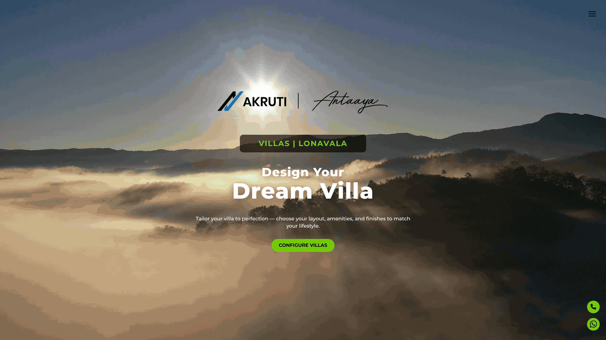

</div>

> [!IMPORTANT]
> **Confidential data has been removed from this public repository.**
> All floor plans, the master site plan, building sections and the aerial site render are replaced by **illustrative placeholders** of the same size, so every feature still works. Unit sizes, room dimensions and area statements are **sample values**, and contact details and credentials are placeholders. See [Data & Confidentiality](#-data--confidentiality).

---

## 📑 Table of Contents

- [Overview](#-overview)
- [User Journey](#-user-journey)
- [Screenshots](#-screenshots)
- [Features](#-features)
- [Technical Highlights](#-technical-highlights)
- [Site Visit Record (internal sales tool)](#-site-visit-record-internal-sales-tool)
- [Tech Stack](#-tech-stack)
- [Project Structure](#-project-structure)
- [Getting Started](#-getting-started)
- [Data & Confidentiality](#-data--confidentiality)
- [Author](#-author)

---

## 🏡 Overview

Buying a luxury villa usually means a sales call, a printed brochure and a lot of imagination. This configurator turns that into a self-guided experience:

1. **Explore** — a cinematic hero, then a regional map that zooms the buyer to the project's location in Lonavala
2. **Choose a unit** — an interactive master layout shows every villa, its type, size and live availability
3. **Configure** — walk through the chosen villa floor by floor, see each room on the plan, and add upgrades (furniture, finishes, landscaping, smart home, pool heating…)
4. **Take it home** — get a personalised, print-ready **30-page brochure PDF** of the villa exactly as configured

It supports three villa types — **RHS**, **LHS** (mirror plans) and **Combo** (a twin-unit 8 BHK) — and works on desktop, tablet and phone.

---

## 🧭 User Journey

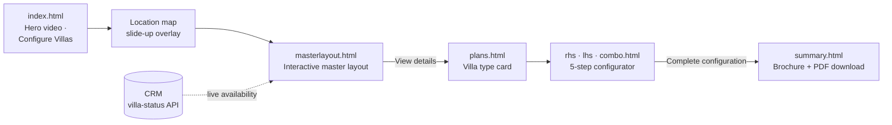

| Step | Page | What happens |
|:-:|---|---|
| 1 | `index.html` | Full-screen video hero → **Configure Villas** slides up the regional location map |
| 2 | `masterlayout.html` | Click any plot to open its info card — series, configuration, plot area, status |
| 3 | `plans.html` | The selected villa's type card with key details → **Configure Your Villa** |
| 4 | `rhs.html` / `lhs.html` / `combo.html` | Villa Layout → Ground Floor → First Floor → Terrace → Villa Summary |
| 5 | `summary.html` | A brochure built from the buyer's choices, downloadable as a 30-page landscape PDF |

The selected villa and every configuration choice travel between pages through `localStorage`, so the flow works on plain static hosting with no backend.

---

## 📸 Screenshots

> Taken from this sanitized repository — plans shown are illustrative placeholders.

### Explore & choose a unit

<table>
  <tr>
    <td width="50%" align="center"><b>Hero</b><br/>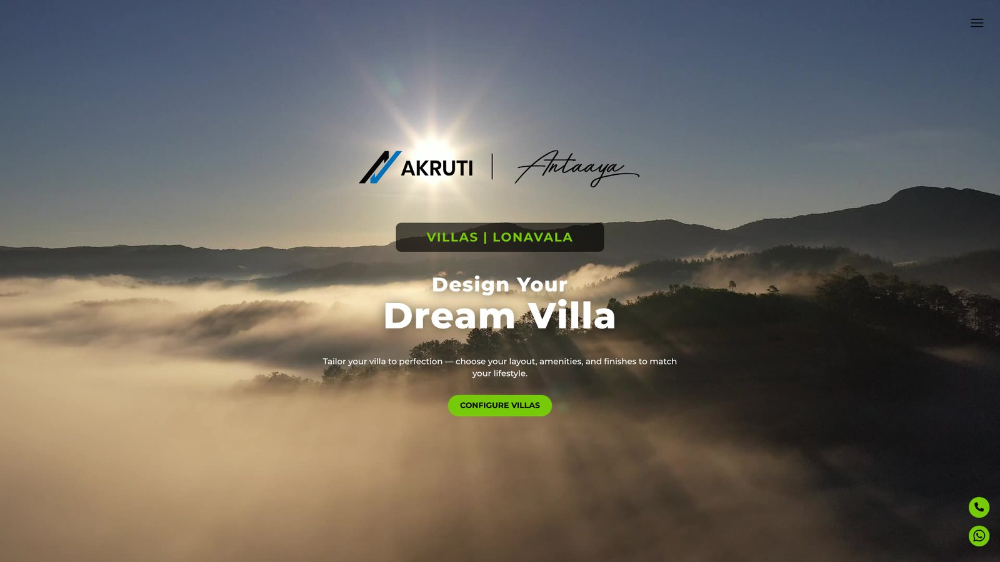</td>
    <td width="50%" align="center"><b>Location map</b><br/>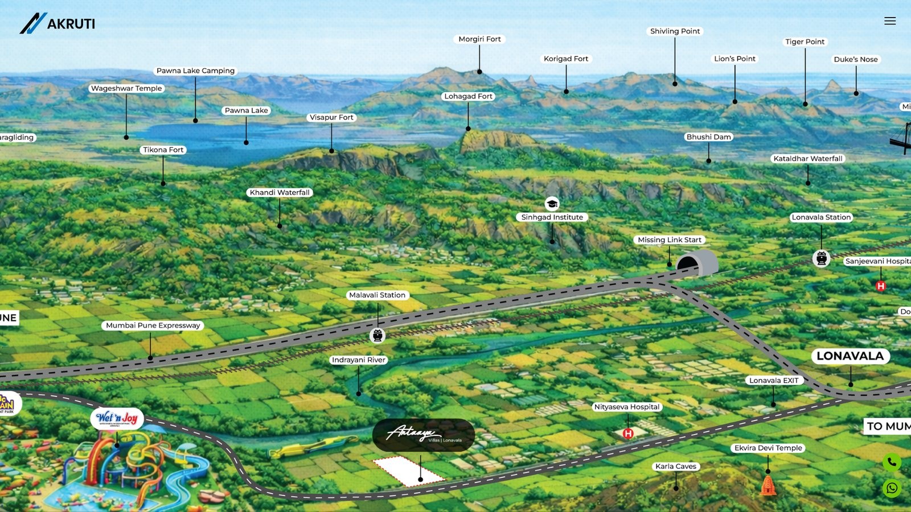</td>
  </tr>
  <tr>
    <td align="center"><b>Interactive master layout</b><br/>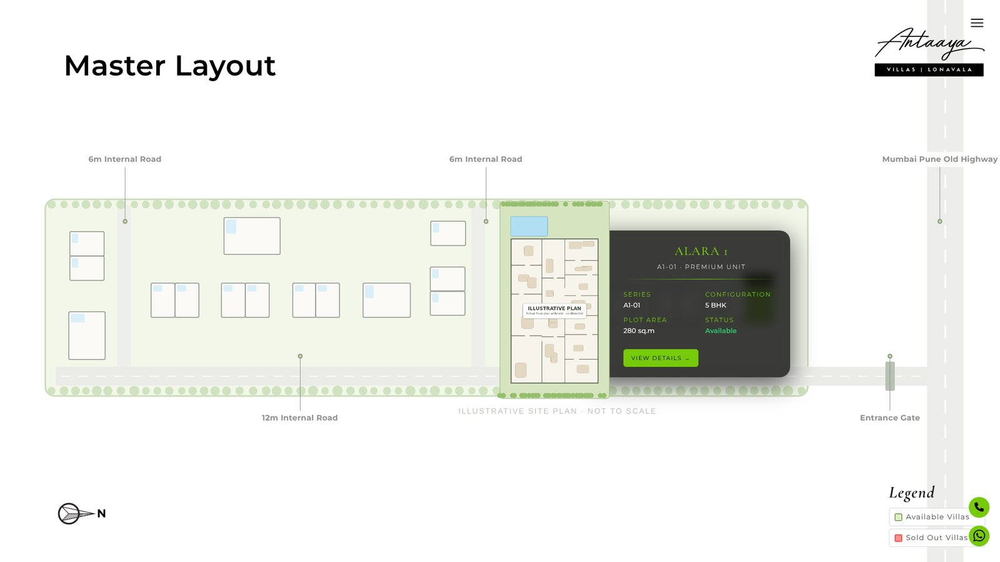</td>
    <td align="center"><b>Villa type</b><br/>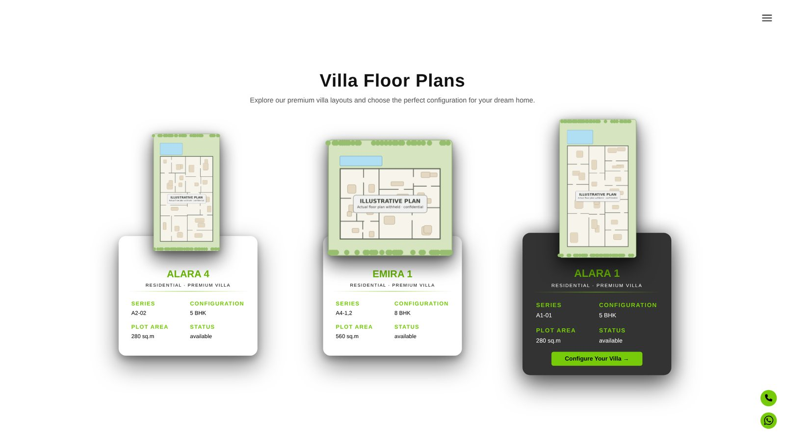</td>
  </tr>
</table>

### Configure floor by floor

<table>
  <tr>
    <td width="50%" align="center"><b>Step 1 · Villa layout</b><br/>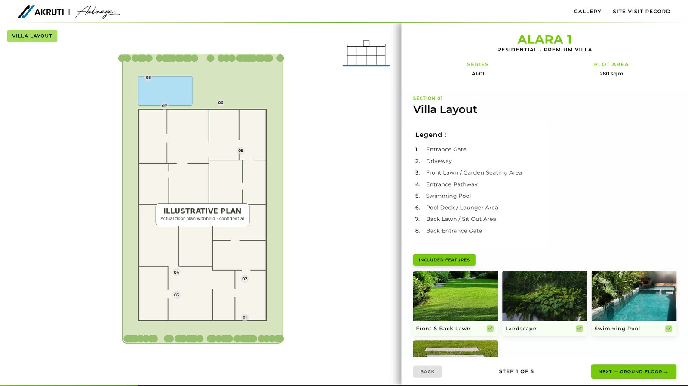</td>
    <td width="50%" align="center"><b>Step 2 · Ground floor — room legend linked to the plan</b><br/>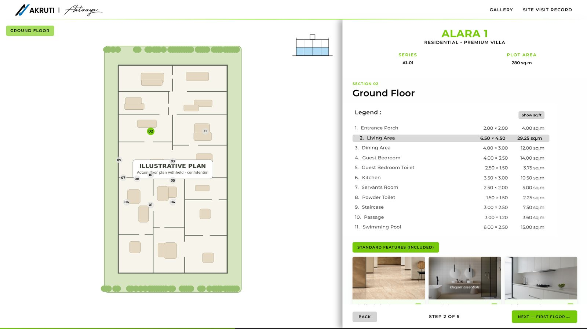</td>
  </tr>
  <tr>
    <td align="center"><b>Add-on confirmation</b><br/>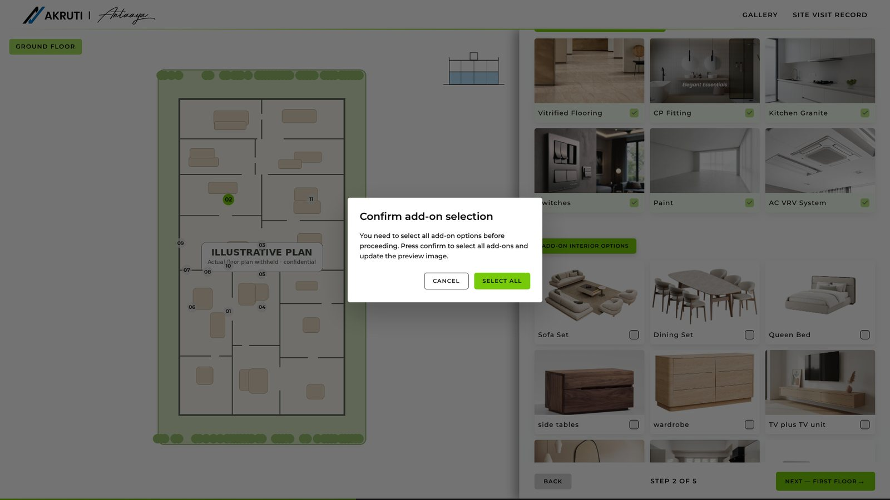</td>
    <td align="center"><b>Step 5 · Villa summary with area statement</b><br/>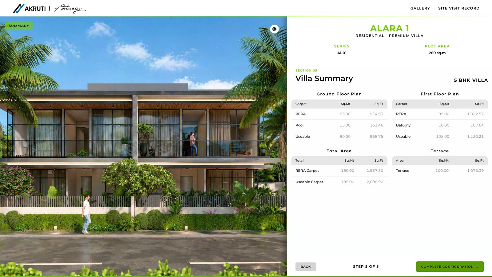</td>
  </tr>
</table>

<div align="center">

**Day · Sunset · Night elevation toggle**


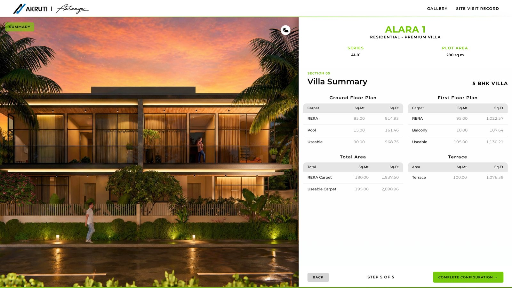
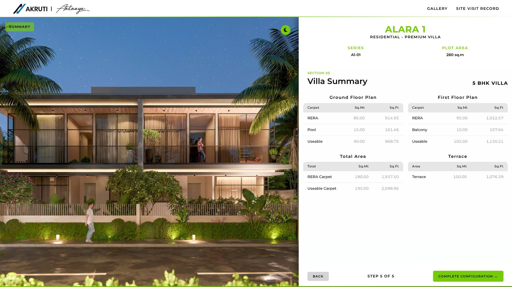

</div>

### Personalised brochure (PDF)

<table>
  <tr>
    <td width="50%" align="center"><b>Cover</b><br/>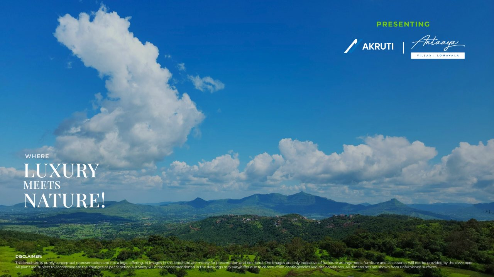</td>
    <td width="50%" align="center"><b>Selected villa</b><br/>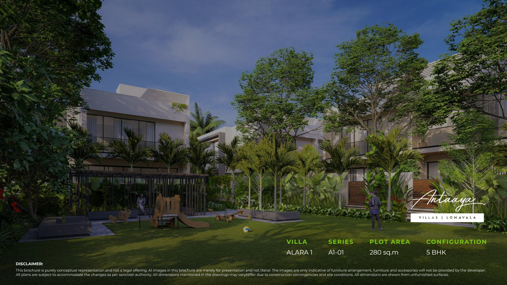</td>
  </tr>
  <tr>
    <td align="center"><b>Floor plan + legend + key section</b><br/>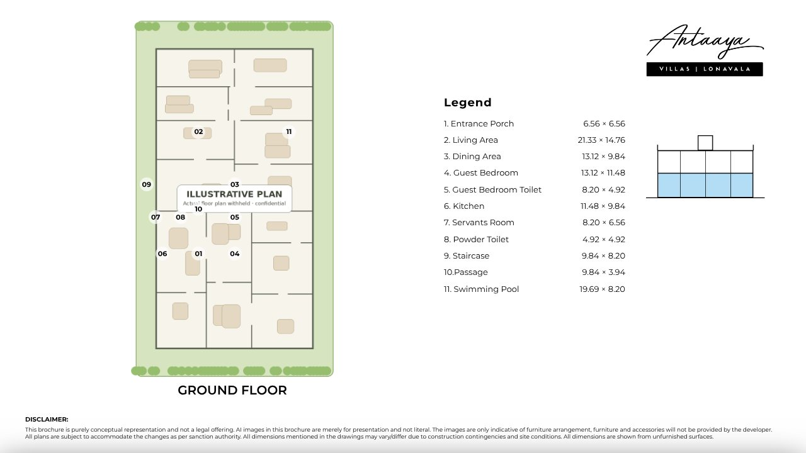</td>
    <td align="center"><b>Buyer's selected features & add-ons</b><br/>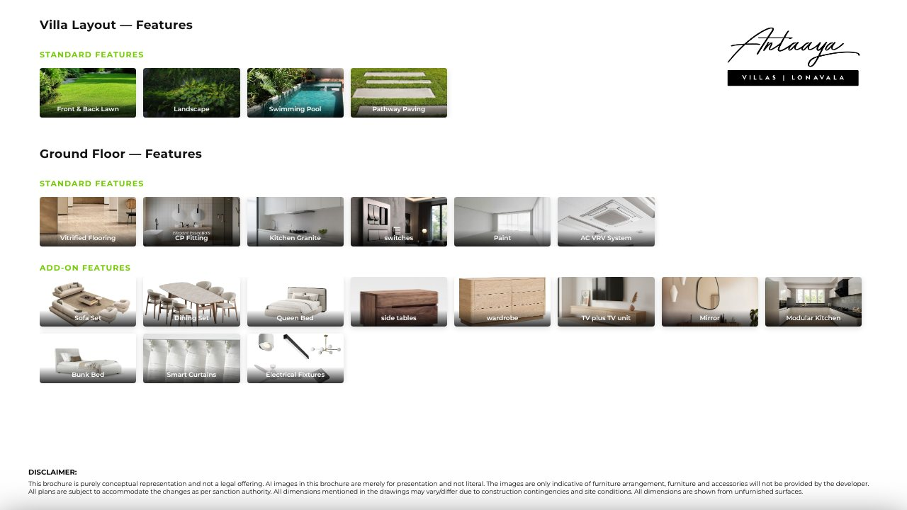</td>
  </tr>
</table>

### Mobile

<div align="center">
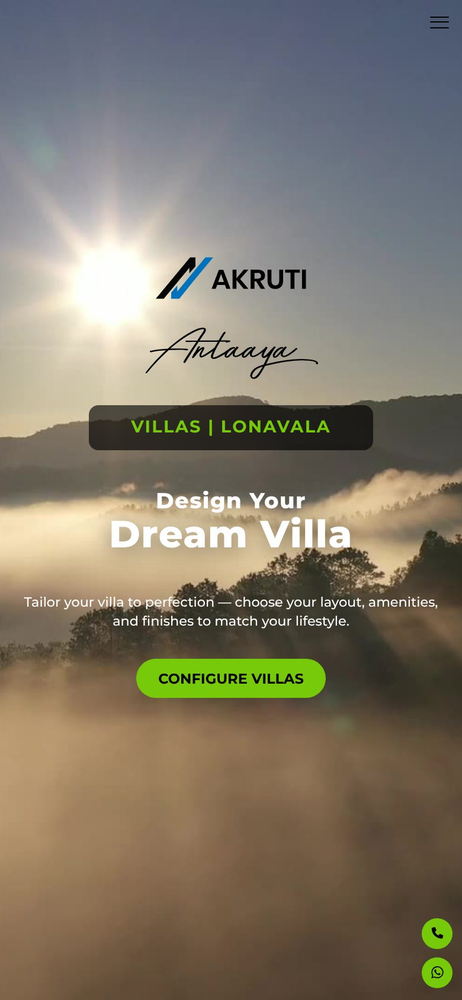&nbsp;&nbsp;
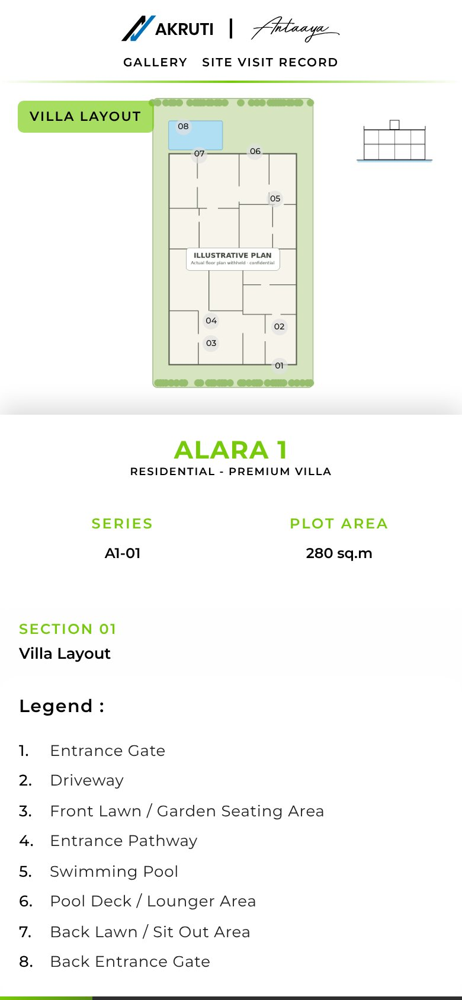&nbsp;&nbsp;
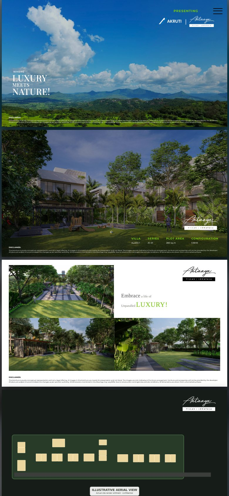
</div>

---

## ✨ Features

<details open>
<summary><b>🗺️ Interactive Master Layout</b></summary>

- Every villa and the clubhouse is a clickable hotspot on a fixed 1920 × 1080 stage
- Info card shows series, configuration, plot area and status, and **positions itself** on whichever side of the plot has room — never off-screen
- **Available / Sold Out filter** highlights matching units and dims the rest
- Sold-out units show a "Sold Out" version of their plan and hide the configure button
- **Live availability** pulled from the sales CRM (`/crm/api/villa-status.php`), matched by villa name or unit serial — falls back silently to the statuses in the HTML if the CRM is unreachable
- Site annotations (internal roads, entrance gate, highway) with choreographed entrance animations
- Closes with ✕, a click outside, or `Esc`

</details>

<details>
<summary><b>🪜 Five-Step Villa Configurator</b></summary>

- **Villa Layout → Ground Floor → First Floor → Terrace → Villa Summary**, with Back / Next and a "Step N of 5" progress bar
- Each floor shows its plan with **numbered room markers**; clicking a legend row highlights that room on the plan
- Legend table with room dimensions and areas, switchable between **sq.m and sq.ft**
- **Standard features** (included) vs **add-on options** (selectable), each with a photo card
- Selecting an add-on asks for confirmation and **swaps the plan image** — e.g. without furniture → with furniture
- **Key section diagram** highlights which floor you're on
- Garden, interior and terrace option groups per floor
- **Day / Sunset / Night** toggle on the villa elevation
- Area statement on the summary step (carpet, pool, balcony, useable, terrace — sq.m and sq.ft)
- Separate pages for **RHS**, **LHS** and **Combo** villas sharing the same engine

</details>

<details>
<summary><b>📄 Personalised Brochure & PDF Export</b></summary>

- `summary.html` assembles a **30-page landscape brochure** (1280 × 720 per page): cover, selected villa details, renders, master layout, every floor plan with its legend and key section, the buyer's chosen features and add-ons, clubhouse, area statement, location & connectivity, amenities and specifications
- **Download PDF** renders each page with **html2canvas** at 2× scale and assembles them with **jsPDF**
- A `waitForImages()` helper makes sure every image is fully loaded before capture, so no page comes out blank
- Live progress on the button ("Rendering page 7 of 30…")

</details>

<details>
<summary><b>📱 Responsive Design</b></summary>

- Fixed-design pages (master layout, configurator) scale as a whole with a JS `transform: scale()` wrapper, so the layout never breaks
- Breakpoints at **1536 / 1440 / 1024 / 768 / 480 px** in a dedicated `responsive.css`
- On phones the location map auto-scrolls to centre the project, and the configurator stacks plan above details
- Floating call / WhatsApp buttons throughout the journey

</details>

---

## 🔧 Technical Highlights

**Keeping room markers glued to the plan — `syncPlanOverlay()`**
Room markers are positioned in percentages over the plan image. Because the image can be letter-boxed (`object-fit: contain`) or stretched (`object-fit: fill`) depending on screen size, `syncPlanOverlay()` reads the image's natural size and the stage's size, works out the actual rendered rectangle and offsets, and resizes the overlay to match — so markers line up at every breakpoint.

**One fixed stage, any screen — master layout scaling**
The master layout is designed on a 1920 × 1080 canvas. A small function computes `min(width / 1920, height / 1080)` and applies a centred `translate + scale` transform on resize. Hotspots, annotations and the info card all live inside that stage, so they stay pixel-aligned with the map.

**Smart info-card placement**
The card measures the clicked plot, prefers the side with enough room (or a side forced per plot via `data-card-side`), then clamps itself inside the map's padding.

**Graceful dependency on the CRM**
Villa availability is fetched from the CRM's public read-only endpoint. Matching works by name *or* serial, and any failure leaves the hard-coded statuses in place — the site never breaks because another system is down.

**State across pages without a backend**
The chosen villa, the list of other available villas and the full configuration (selected cards, legends, add-ons per floor) are serialized to `localStorage` and rebuilt on the next page.

**Back-button safety**
A `pageshow` listener detects pages restored from the browser's back/forward cache and resets the view, so the hero and map overlay never come back half-open.

**Reliable PDF output**
Images are awaited before capture, an export mode class removes on-screen-only UI, and each 1280 × 720 page is rendered separately — keeping memory use stable on long brochures.

---

## 📋 Site Visit Record (internal sales tool)

`SiteVisit-Record.html` is an internal tool used by the sales team at the site office, linked from the corner menu.

- Three tabs: **Site Visit**, **Broker Entry** and **Enquiry**
- Each tab posts to its own **Google Sheet** through a Google Apps Script web app
- Every submission is also sent to the **CRM's intake API** — if the CRM is unreachable, the submission is stored in a **local retry queue** and re-sent automatically later
- `site-visit-mail.php` emails a styled visit summary to the sales team via **PHPMailer** over Gmail SMTP

---

## 🛠️ Tech Stack

| Layer | Technology |
|---|---|
| **Front end** | HTML5, CSS3 (custom, no framework for layout), vanilla JavaScript (ES6) |
| **Libraries** | html2canvas · jsPDF · Font Awesome · Bootstrap (utilities) |
| **Typography** | Cormorant Garamond · Montserrat · Playfair Display |
| **Back end** | PHP + PHPMailer (site-visit email only) |
| **Integrations** | Google Apps Script → Google Sheets, CRM villa-status & intake APIs, WhatsApp / tel links |
| **Hosting** | Apache shared hosting (Bluehost) |

---

## 📁 Project Structure

```
antaaya-villa-configurator/
├── index.html               # Hero video + regional location map
├── masterlayout.html        # Interactive master layout (1920×1080 stage)
├── plans.html               # Selected villa type card
├── rhs.html                 # Configurator — RHS villa
├── lhs.html                 # Configurator — LHS villa
├── combo.html               # Configurator — Combo (twin) villa
├── summary.html             # Personalised brochure + PDF export
├── SiteVisit-Record.html    # Internal sales tool (site visit / broker / enquiry)
├── site-visit-mail.php      # PHPMailer handler for the site visit form
├── config.example.php       # → copy to config.php (gitignored)
│
├── Configure.js             # Shared JS: nav, hero → map, master layout logic
├── style.css                # Shared styles
├── responsive.css           # All breakpoints
│
├── image/
│   ├── villas/              # Villa layouts, sold-out variants, clubhouse, key sections  (placeholders)
│   ├── rhs-villas/          # RHS floor plans, with / without furniture                   (placeholders)
│   ├── lhs-villa/           # LHS floor plans                                             (placeholders)
│   ├── combo/               # Combo floor plans                                           (placeholders)
│   ├── add-on/              # Feature & add-on photos, day / sunset / night elevations
│   ├── summary/             # Brochure renders and backgrounds
│   └── master-layout-svg-new.svg   # Master layout base map                              (schematic)
├── video/Configure.mp4      # Hero background video
├── vendor/                  # PHPMailer (Composer)
└── assets/screenshots/      # README images
```

---

## 🚀 Getting Started

The configurator is static HTML/CSS/JS — any web server works.

**1. Clone**
```bash
git clone https://github.com/Rohit55-Code/antaaya-villa-configurator.git
cd antaaya-villa-configurator
```

**2. Serve it** (pick one)
```bash
# Python
python -m http.server 8000
# or Node
npx serve .
```
Or open the folder with VS Code's **Live Server**, or place it in `C:\xampp\htdocs\`.

**3. Open** `http://localhost:8000/index.html`

> Opening the HTML files directly (`file://`) may block `localStorage` sharing and the PDF export in some browsers — use a local server.

**Optional — site visit email (PHP)**
```bash
cp config.example.php config.php
```
Fill in your SMTP and Apps Script details in `config.php`, then serve with PHP (e.g. XAMPP).
Without the CRM, the master layout simply uses the availability written in `masterlayout.html`.

---

## 🔐 Data & Confidentiality

This is a live commercial project, so the public repository is sanitized:

| What | In this repo |
|---|---|
| Floor plans (RHS, LHS, Combo — all floors, with / without furniture) | Illustrative placeholder plans, same file names and pixel sizes |
| Villa layouts, sold-out variants, clubhouse plans | Illustrative placeholders |
| Building key sections | Generic section diagrams (still highlight the active floor) |
| Master site plan | Schematic redrawn from the hotspot positions in the code |
| Aerial site render | Placeholder |
| Plot areas, room dimensions, RERA / useable area statements | Sample values |
| Phone number, RERA registration no., staff names | Placeholders |
| Gmail App Password, Google Apps Script URLs | Removed — `config.example.php` / placeholder URLs |

Marketing renders, product photos and logos are kept for presentation.

---

## 👨‍💻 Author

<div align="center">

**Rohit Patil**
Full Stack Developer 

[](https://github.com/Rohit55-Code)

<sub>Shared for portfolio purposes. Confidential plans and data have been removed. © Akruti Developer Ltd.</sub>

</div>
